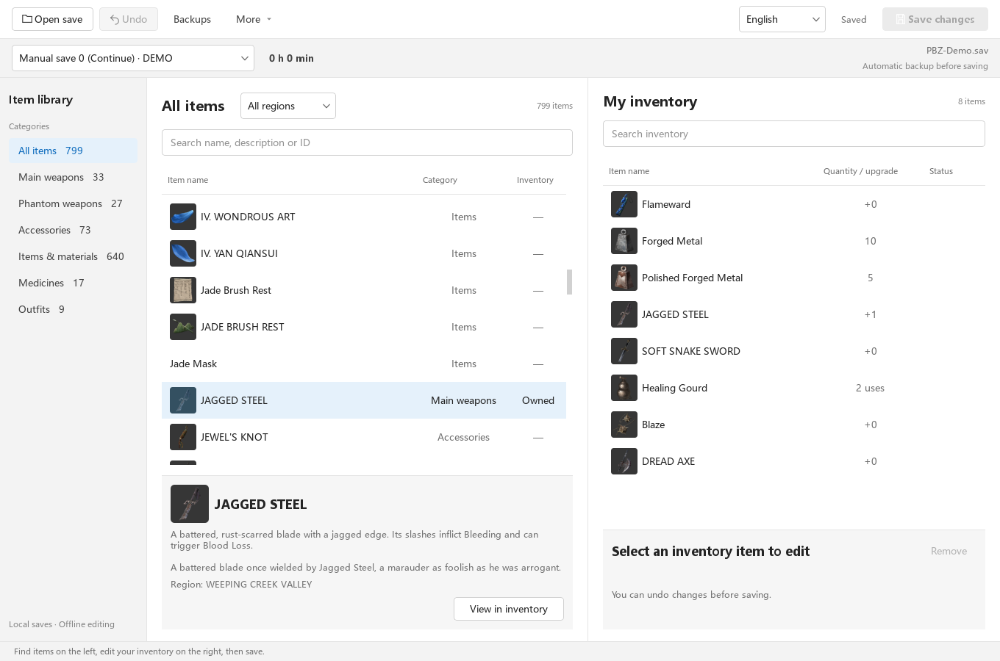
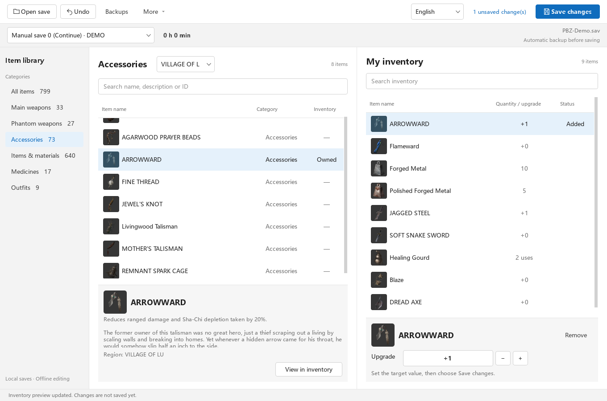
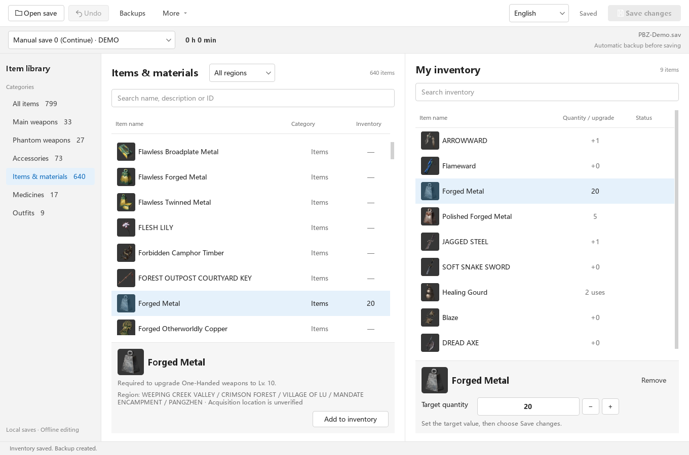

# PBZ Editor

[简体中文](README.md) | English

Offline Windows save editor · Free and open source (MIT) · Chinese / English

This started with one missed item: **Arrowward**.

The plan was to get it back. That grew into a small editor with item search, map filters and icons from the game. Find something, add it to your inventory, adjust its quantity or upgrade level, then save. You can recover a missed piece of gear or try another weapon without leaving the window.

**[Download the Windows app](https://github.com/maydaysuper/PBZ-Editor/releases/download/v0.3.1/PBZ-Editor-0.3.1-windows-x64.zip)** · [Release and checksums](https://github.com/maydaysuper/PBZ-Editor/releases/tag/v0.3.1) · [What's new](docs/releases/0.3.1.en.md)

The current release is **v0.3.1 preview** for Windows x64. Steam build **26266538** is the tested reference. After a game update, the editor checks the save and item data automatically; compatible features remain available rather than blocking an entire build number. A category whose numeric layout cannot be confirmed stays view-only, so unknown structures are not written.

## A quick look

These are captures of the actual app using a generated demo inventory. The file is called `PBZ-Demo.sav`; no player progress appears here.

**1. Find an item.** Browse categories on the left, search by name or filter by map. Your inventory sits on the right.

**2. Add it and adjust its values.** Here, Arrowward is found through the Village of Lu filter, added to the inventory and upgraded to +1. The top bar shows one unsaved change.

**3. Save when you're ready.** Material quantities accept a target value directly. After clicking **Save changes**, the bottom message confirms the save and automatic backup.

## Give it a try

1. Download `PBZ-Editor-0.3.1-windows-x64.zip`, **extract the whole archive**, and exit the game.
2. Run `PBZ-Editor.exe`. It usually finds the game and save for you. If it doesn't, choose them manually; if several accounts appear, pick your own progress.
3. Search the item library by name, or browse by category and map. Select an item and click **Add to inventory**.
4. Adjust its quantity or level on the right, then click **Save changes** in the top corner.

No Python installation or manual DLL setup needed. The first launch takes a little time to prepare item data and icons from your installed game; later launches use the cache. Pick **`windows-x64.zip`** on the download page. The `Source code` archives are for people who want to work on the code.

Switch between **简体中文 / English** at the top. Pending edits stay with you, and the app remembers your language next time.

## What you can edit

Main weapons, phantom weapons, accessories, items and materials, medicines, and full outfits: **799 editable entries** in the supported build. Names, descriptions and icons come from your installed game, as do the map associations. Where English text is missing, the original name or internal ID stays visible.

While you're choosing items and changing values, edits stay in the preview. **The save file changes only when you save.** Undo is available, and you can export to a separate copy if you'd like to try things out first. Each write gets an automatic backup; open **Backups** at the top to find it.

A few things to keep in mind:

- **Adding a quest item doesn't complete its quest.** The editor doesn't replay story events.
- **Medicine uses still follow the game's rules.** Loading may refill them, so arbitrary counts aren't guaranteed to stay exactly as entered.
- A map association isn't necessarily the only place to get an item. Full outfits unlock in the account wardrobe.

Five sample categories passed a game load, manual save, exit and readback in v0.2.0. This release adds automatic compatibility and file-roundtrip tests; other game builds have not been tested in-game. The [validation notes](docs/validation.en.md) explain what has been tested and what remains uncertain.

## What happens after a game update?

Open the editor as usual. Relocated key material or changed item values can continue working when format checks pass. A changed item schema makes only that category read-only. Unavailable map data doesn't stop search or category browsing.

A save layout that can be fully read but isn't supported for writing opens read-only. If decryption or complete parsing fails, the editor explains why and stops. There is no build selector or force-write override. See [automatic compatibility](docs/compatibility.en.md) for the details.

## Updates and backups

Settings, caches and backups live in `%LOCALAPPDATA%\PBZ-Editor` by default. To upgrade, extract the complete new version and run its EXE. Keep the application folder together; copying just the EXE won't work.

Prefer to keep everything beside the app? Create an empty `portable.flag` next to the EXE. This enables portable mode, with data in the adjacent `.local` folder. Keep that folder when upgrading.

## Help improve it

Missing item, unexpected value, or a step that feels awkward? [Open an issue](https://github.com/qry6868/PBZ-Editor/issues/new/choose). Include the editor version, game build, steps and error text so it's easier to reproduce. **Please leave saves and complete private logs out of public reports.**

If you'd like to change the code, start with the [build guide](docs/building.en.md). The editor leaves game installation files alone. Apart from the UI screenshots in the docs, no extracted game images or full game text are distributed in the repository or runtime. Player saves aren't included either.

This is a community project, unaffiliated with the game developer. Project code is [MIT licensed](LICENSE); bundled components are listed in [THIRD_PARTY_NOTICES.md](THIRD_PARTY_NOTICES.md).
