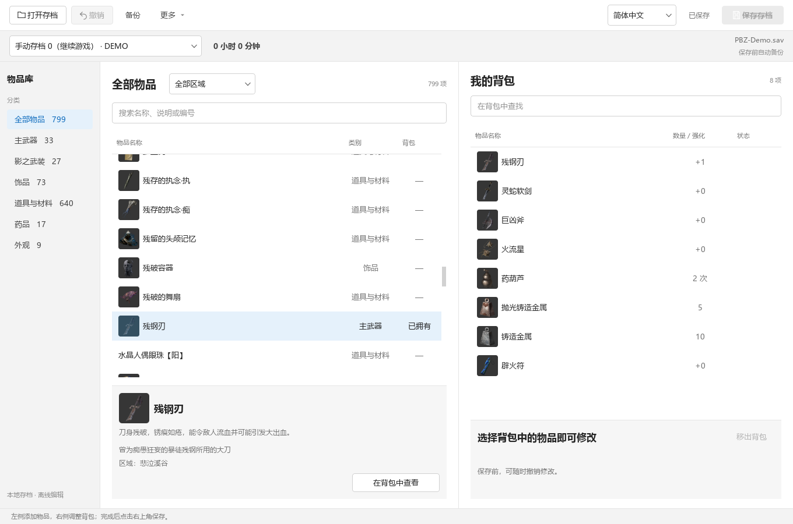
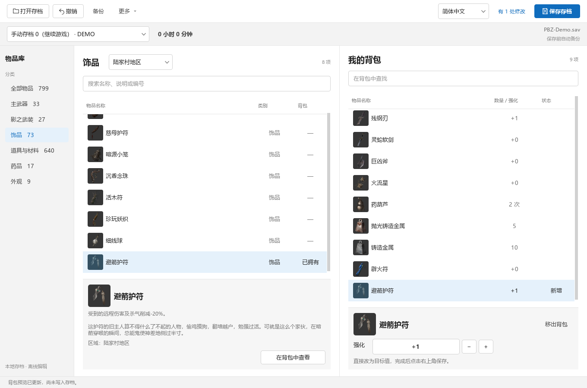
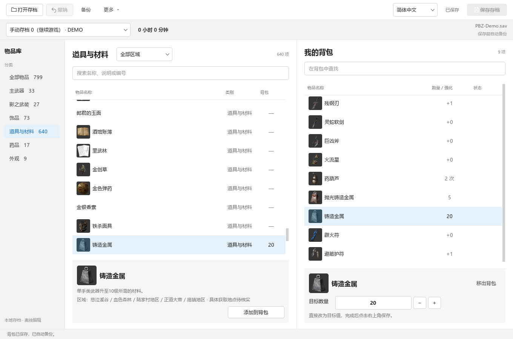

# PBZ Editor · 影之刃零物品编辑器

简体中文 | [English](README.en.md)

Windows 离线存档编辑器 · 免费开源（MIT） · 中文 / English

事情的起因是一件没拿到的「避箭护符」。

原本只是想把它补回来，后来索性把物品搜索、地图筛选和游戏图标都做进去了：找到想要的东西，加进背包，改好数量或等级，再保存。补一件错过的装备，或是试试别的武器，都能在一个窗口里完成。

**[直接下载 Windows 运行包](https://github.com/maydaysuper/PBZ-Editor/releases/download/v0.3.1/PBZ-Editor-0.3.1-windows-x64.zip)** · [发布页与校验和](https://github.com/maydaysuper/PBZ-Editor/releases/tag/v0.3.1) · [更新说明](docs/releases/0.3.1.zh-CN.md)

目前是 **v0.3.1 预览版**，运行于 Windows x64。已验证的参考环境是 Steam build **26266538**；游戏更新后会自动检查存档和物品数据，兼容的部分可以继续编辑，不再按版本号整包拦住。某一类数值结构无法确认时，该类保持只读，避免写入未知布局。

## 看看怎么用

下面是实际程序界面，背包内容为专门生成的演示数据，存档名为 `PBZ-Demo.sav`，不含玩家进度。

**1. 找物品。** 左侧选类别，也可以搜索名称或按地图筛选；右侧是当前背包。

**2. 加进背包，调整数值。** 这里在陆家村区域找到避箭护符，添加后把强化设为 +1。右上角提示还有 1 处修改未保存。

**3. 改好后保存。** 材料数量可以直接填目标值。点击「保存存档」后，底部会提示保存和自动备份已完成。

## 先用起来

1. 下载 `PBZ-Editor-0.3.1-windows-x64.zip`，**完整解压**，退出游戏。
2. 双击 `PBZ-Editor.exe`。通常会自动找到游戏和存档；没找到就手动选一下，有多个账号时选自己的进度。
3. 在物品库搜索名称，或按类别、地图找。选中物品，点「添加到背包」。
4. 在右侧调整数量、等级，最后点右上角的「保存存档」。

不需要装 Python，也不用自己找 DLL。第一次打开会从你安装的游戏里准备物品清单和图标，稍等一会儿，之后就会用缓存。下载时认准 **`windows-x64.zip`**；`Source code` 是给想看源码的人准备的。

顶部可以切换 **简体中文 / English**，正在改的背包会保留，下次打开也会记住语言。

## 能改什么

主武器、影之武装、饰品、道具材料、药品和完整服装，目前共有 **799 个可编辑条目**。物品名称、说明和图标都从本机游戏读取，地图筛选也来自游戏里的关联信息。英文资源缺少翻译的地方，会保留原名或内部 ID。

选物品、调数值时，改动先留在预览里，**点保存才写入存档**。改错了可以撤销，想先试试可以「另存为副本」。每次写入前会自动备份，顶部的「备份」里能找到。

有几件事先说清楚：

- **加了任务物品，不等于任务也完成了。** 工具不会替你补跑剧情事件。
- **药品次数会受游戏规则影响。** 比如读档后可能被补满，不能保证你填的任意次数都原样留下。
- 地图关联不一定是唯一获取地点；完整服装会解锁账号衣柜。

v0.2.0 的五类样品通过了游戏载入、手动保存、退出后的回读检查。本版新增了自动兼容检测和文件往返测试，还没有其他游戏版本的实机验证。[测过什么、还有哪些限制](docs/validation.zh-CN.md)都单独记在这里，遇到具体物品拿不准时可以看一下。

## 游戏更新了怎么办

照常打开工具，它会自己检查。密钥位置移动或物品表里的数值变化，只要格式检查通过，就可以继续用。某一类物品结构变了，只会把那一类设为只读；地图暂时认不出来，也不影响搜索和分类。

能完整读取、但尚不支持写入的存档格式会进入只读模式。无法解密或完整解析时会说明原因并停止，不会猜着写。无需手动选 build，也没有强制跳过检查的开关。详细规则见 [自动兼容说明](docs/compatibility.zh-CN.md)。

## 升级和备份放哪儿

默认都在 `%LOCALAPPDATA%\PBZ-Editor`，换新版程序不会带走你的设置和备份。升级时完整解压新版本，运行新的 EXE 就行，别只拎走一个 EXE 文件。

想把数据和程序放一起，可以在 EXE 旁创建一个空的 `portable.flag` 文件，启用便携模式。数据会放进旁边的 `.local` 文件夹，升级时记得留着它。

## 一起改进

找不到物品、数值不对，或者觉得哪一步用着别扭，都欢迎 [开个 Issue](https://github.com/qry6868/PBZ-Editor/issues/new/choose)。带上编辑器版本、游戏 build、操作步骤和报错文字，会更容易查。**公开反馈里不用附上你的存档或完整私人日志。**

想自己改一改，可以看 [构建说明](docs/building.zh-CN.md)。程序不修改游戏安装文件。除了文档里的界面截图，仓库和运行包不附带提取的游戏图片或完整游戏文字，也不包含玩家存档。

社区项目，与游戏官方无关联。源码使用 [MIT](LICENSE) 许可证；第三方组件见 [THIRD_PARTY_NOTICES.md](THIRD_PARTY_NOTICES.md)。
